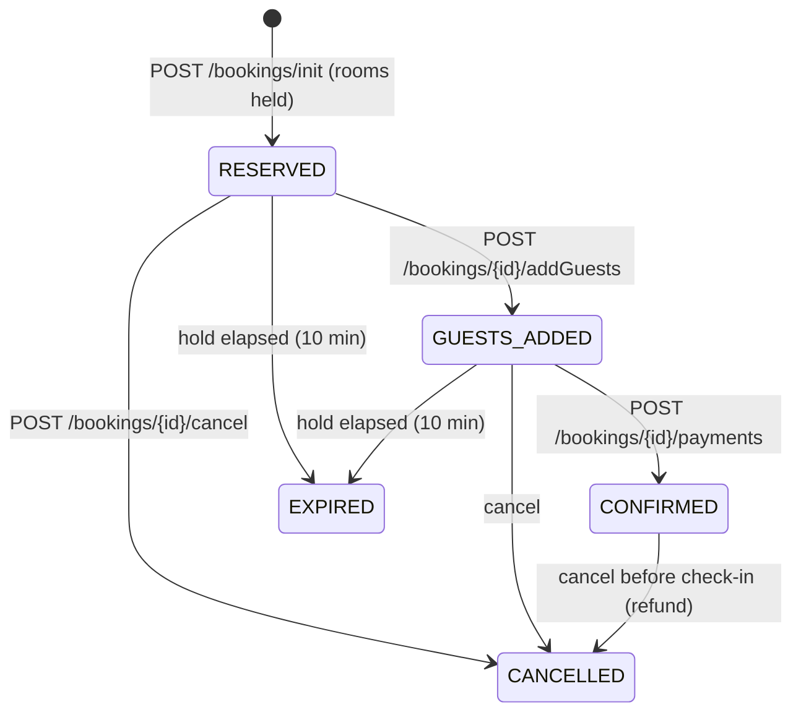

# StayEase — Hotel Booking Platform (Airbnb-style)

A full-stack hotel booking app: guests search hotels by city and dates, see live prices and availability, book rooms with a time-limited hold and pay; hotel managers publish hotels, add room types and manage their listings.

**Stack:** React 18 · Spring Boot 3.4 (Java 17+) · Spring Security with JWT · MySQL 8 + Flyway · JUnit 5, MockMvc and Testcontainers

---

## Features

### Guests
- **Search** by city or hotel name, dates and number of rooms. A hotel only appears if a *single* room type is free for every night of the stay; results show the cheapest such room's average nightly price, cheapest first, with pagination.
- **Hotel page** with each room's real price and availability for the chosen dates (sold-out rooms are greyed out). Browsing is public; signing in is only needed to reserve.
- **Booking flow**: reserve → add guests → pay → confirmed. Reserving puts the rooms on a **10-minute hold**; unpaid holds expire automatically and release the rooms.
- **My Bookings**: every booking with its status, total and guests; cancel before check-in (confirmed bookings are refunded), or finish paying for a held booking.

### Hotel managers
- Create and edit hotels (photos, amenities, contact details), add room types (price, count, capacity), and **activate / deactivate** listings. New hotels start unpublished.
- Managers only ever see and change **their own** hotels, rooms and inventory. Hotels or rooms with bookings can't be deleted — deactivate them instead.

### Under the hood
- **Inventory**: one row per room type per night, created a year ahead when a hotel is activated and rolled forward by a daily job. Reserved and booked counts are tracked separately.
- **Concurrency**: booking, payment, cancellation and expiry lock the booking row and then its inventory rows (in date order) with `SELECT … FOR UPDATE`, so two guests can't book the last room and concurrent requests can't deadlock. The hourly pricing job writes only the `price` column, so it can't overwrite room counts.
- **Dynamic pricing**: an hourly job recomputes nightly prices with a chain of decorator strategies — base price → surge factor → occupancy (> 80% booked: +20%) → urgency (within 7 days: +15%) → holidays (configurable dates: +25%). The chain is assembled in `PricingService`.
- **Payments** go through a `PaymentGateway` interface. The app ships with `MockPaymentGateway` (no real money moves); a real provider can be plugged in by implementing it.
- **Security**: signed, expiring HS256 JWTs; logout revokes all of a user's tokens; role-based routes (`GUEST`, `HOTEL_MANAGER`); ownership checks that answer 404 for other users' resources; rate-limited login and signup; unknown emails take as long to reject as wrong passwords, so login timing doesn't reveal which accounts exist.
- **API quality**: Bean Validation on every request; correct 4xx statuses with field-level messages; every response — success or error — uses the same `{ timeStamp, data, error }` envelope, and internal error details are never sent to clients.

### Booking lifecycle



---

## Project structure

```
airbnb-fullstack/
├── airBnbApp/                 # Spring Boot backend (context path /api/v1)
│   ├── src/main/java/.../     # controller · service · repository · entity · dto · security · strategy
│   ├── src/main/resources/
│   │   └── db/migration/      # Flyway migrations
│   ├── db/                    # SQL to create a local MySQL database and user
│   └── .env.example           # local settings template
├── airbnb-frontend/           # React app (Create React App)
│   └── src/                   # pages · components · context · services/api.js · utils
└── docker-compose.yml         # MySQL 8 for local development
```

---

## Getting started

### Prerequisites
- Java 17 or newer (the Maven wrapper `./mvnw` is included, so Maven itself isn't required)
- Node.js 18+ and npm
- MySQL 8 — installed locally, or run with Docker

### 1. Database
Either:
- **Local MySQL:** run [`airBnbApp/db/create-local-database.sql`](airBnbApp/db/create-local-database.sql) as an admin user (e.g. in MySQL Workbench). It creates the `airbnb` database and an `airbnb_app` user.
- **Docker:** `docker compose up -d db` starts MySQL 8.4 on port **3307** using the defaults in [`docker-compose.yml`](docker-compose.yml).

Flyway creates and upgrades the tables on startup.

### 2. Backend

```bash
cd airBnbApp
cp .env.example .env      # then fill in DB_PASSWORD and JWT_SECRET
./mvnw spring-boot:run
```

The API runs at **http://localhost:8080/api/v1**. Settings are read from `airBnbApp/.env` (git-ignored) or from environment variables:

| Variable | Purpose | Default |
|---|---|---|
| `DB_URL` | JDBC URL | `jdbc:mysql://localhost:3306/airbnb` |
| `DB_USERNAME` / `DB_PASSWORD` | Database credentials | `airbnb_app` / *(none)* |
| `JWT_SECRET` | Token signing key, at least 32 characters (`openssl rand -base64 48`). If unset, a random key is used and every restart signs everyone out | *(random)* |
| `JWT_EXPIRATION_MINUTES` | Token lifetime | `60` |
| `SEED_DEMO_DATA` | On an empty database, create demo accounts and three hotels. **Local development only** | `false` |
| `API_DOCS_ENABLED` | Serve Swagger UI and the OpenAPI spec | `true` |

### 3. Frontend

```bash
cd airbnb-frontend
npm install
npm start
```

The app opens at **http://localhost:3000**. It calls `http://localhost:8080/api/v1` by default; to change that, copy `.env.example` to `.env` and set `REACT_APP_API_URL`.

### Demo accounts
With `SEED_DEMO_DATA=true`, sign in as:

| Role | Email | Password |
|---|---|---|
| Guest | `guest@demo.com` | `password123` |
| Hotel manager | `manager@demo.com` | `password123` |

---

## API

Interactive documentation (Swagger UI) is served by the running backend at **http://localhost:8080/api/v1/swagger-ui/index.html** — sign in with `POST /auth/login`, click **Authorize** and paste the token to try protected endpoints.

All paths below are relative to `/api/v1`.

| Method | Path | Access | Description |
|---|---|---|---|
| POST | `/auth/signup` | Public | Create an account (`GUEST` by default, or `HOTEL_MANAGER`) and get a token |
| POST | `/auth/login` | Public | Sign in and get a token |
| POST | `/auth/logout` | Signed in | Revoke all of the user's tokens |
| POST | `/hotels/search` | Public | Search by city or hotel name, dates and rooms (paginated) |
| GET | `/hotels/{id}/info` | Public | Hotel and rooms; with `startDate`, `endDate`, `roomsCount` also each room's price and availability |
| GET | `/bookings` | Guest | The user's bookings, newest first |
| POST | `/bookings/init` | Guest | Reserve rooms (starts the 10-minute hold) |
| POST | `/bookings/{id}/addGuests` | Guest | Add guest details |
| POST | `/bookings/{id}/payments` | Guest | Pay and confirm |
| POST | `/bookings/{id}/cancel` | Guest | Cancel before check-in (refunds confirmed bookings) |
| GET / POST | `/admin/hotels` | Manager | List own hotels / create a hotel |
| GET / PUT / DELETE | `/admin/hotels/{id}` | Manager | View / update / delete a hotel |
| PATCH | `/admin/hotels/{id}/activate` | Manager | Publish a hotel and create its inventory |
| PATCH | `/admin/hotels/{id}/deactivate` | Manager | Hide a hotel and stop new bookings |
| GET / POST | `/admin/hotels/{id}/rooms` | Manager | List / add room types |
| GET / DELETE | `/admin/hotels/{id}/rooms/{roomId}` | Manager | View / delete a room type |

Every response has the shape `{ "timeStamp": …, "data": …, "error": { "status", "message", "subErrors" } }`.

---

## Testing

```bash
cd airBnbApp && ./mvnw test        # backend: 78 tests
cd airbnb-frontend && npm test     # frontend: unit tests for date and price helpers
```

- Backend integration tests run the full Spring context with MockMvc against an in-memory H2 database (MySQL mode). They cover authentication and authorization, ownership checks, the booking lifecycle with inventory counts asserted after every step, hold expiry, search, hotel administration, pricing strategies, error responses, validation and the API docs.
- `MySqlSchemaTest` starts a real MySQL 8.4 with Testcontainers to verify the Flyway migrations, schema validation, the native search SQL and row locking. It runs when Docker is available and is skipped otherwise.

---

## Known limitations
- **Payments are mocked** — `MockPaymentGateway` always succeeds; a real provider needs its own `PaymentGateway` implementation (plus webhooks for asynchronous payments).
- **Rate limiting is in memory**, so limits are per backend instance; a shared store such as Redis is needed when scaling out.
- **Tokens are stored in `localStorage`**; httpOnly cookies would protect them better against XSS.
- **Search matches cities exactly** (case-insensitive) and hotel names partially — there is no geo or fuzzy search.
- Room types can be added and deleted but not edited, and there is no endpoint yet to close inventory for specific dates or change a room's surge factor.

---

## License
This project is for educational purposes.
